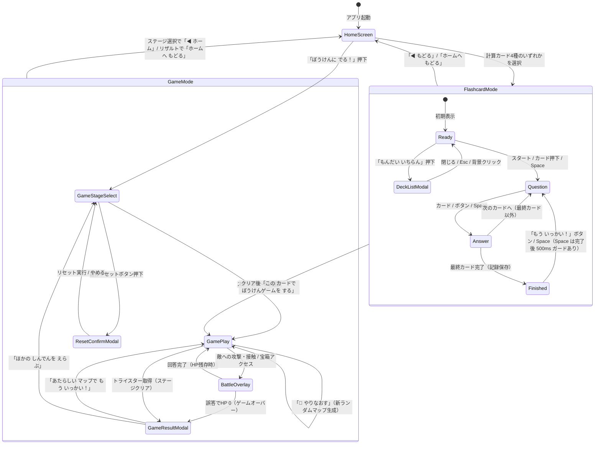

# けいさんカード ＆ けいさんクエスト 仕様書

- **対象リポジトリ**: `beagleworks/keisanapp`
- **アプリ名**: けいさんカード ＆ けいさんクエスト
- **バージョン**: 1.0.0
- **対象ユーザー**: 小学校1年生および保護者
- **配信形態**: 完全クライアントサイド SPA（GitHub Pages 静的ホスティング）

---

## 1. 概要・目的

本アプリは、小学校1年生の算数で用いる紙の「けいさんカード」をスマートフォンおよび PC のブラウザで代用・強化するための学習用 Web アプリである。  
以下の2つのモードを備える。

1. **けいさんカード練習モード**: ちびむすドリル【大サイズ】の計算カード4種類（全162問）に準拠したフラッシュカード練習。毎回シャッフル出題・タイム計測・ベストタイム保存に対応する。
2. **けいさんクエスト（ゲームモード）**: 初代ゼルダ風のトップダウン2DアクションRPGに計算バトルを組み合わせたゲームモード。全5ステージ（単元別4面＋総合問題5面）を備え、プレイごとにランダムダンジョンを自動生成する。ハイスコア・ランク評価・進捗リセットに対応する。

### 1.1 技術スタック・動作環境

| 項目 | 内容 |
| --- | --- |
| UI フレームワーク | React 19 (`^19.0.0`) |
| 言語 | TypeScript (`^5.7.3`, `strict: true`, `noUnusedLocals`, `noUnusedParameters`) |
| ビルドツール | Vite 8 (`^8.3.8`, `base: './'`) |
| テストフレームワーク | Vitest 5 (`^5.1.1`, `environment: 'node'`) |
| パッケージマネージャ | `pnpm` (`pnpm@10.33.4`) |
| グラフィック描画 | HTML5 Canvas 2D API（ピクセルアート描画、`imageSmoothingEnabled = false`） |
| 音声合成 | Web Audio API（外部音声ファイル不使用のシンセサイザー効果音） |
| データ永続化 | ブラウザ `window.localStorage`（サーバー・DB不使用） |
| フォント | Google Fonts `M PLUS Rounded 1c`（ウェイト 500 / 700 / 800 / 900） |
| 対応デバイス | スマートフォン（タッチ操作）・タブレット・PC（キーボード／マウス操作） |

---

## 2. システム構成・ディレクトリ構成

```text
.
├── .github/workflows/deploy.yml   # GitHub Pages 自動テスト・ビルド・デプロイ
├── AGENTS.md                      # AI エージェント／レビュー運用ルール
├── docs/SPEC.md                   # 本仕様書
├── index.html                     # エントリー HTML（viewport・フォント読込）
├── public/favicon.svg             # アプリアイコン
├── src/
│   ├── main.tsx                   # React エントリーポイント（StrictMode）
│   ├── App.tsx                    # ルート画面状態管理（home / flashcard / game）
│   ├── index.css                  # 全画面スタイル・レスポンシブ定義
│   ├── data/
│   │   ├── decks.ts               # 4単元162問定義・シャッフル・ミックス出題・4択生成
│   │   └── decks.test.ts          # カード枚数・内容・ミックス出題・4択単体テスト
│   ├── components/
│   │   ├── HomeScreen.tsx         # ホーム画面（デッキ選択・ゲーム導線・記録サマリー）
│   │   ├── FlashcardMode.tsx      # けいさんカード練習画面
│   │   └── DeckListModal.tsx      # 単元別もんだい一覧モーダル
│   ├── game/
│   │   ├── types.ts               # ゲーム共通定数・型定義
│   │   ├── worlds.ts              # ステージ1〜5のテーマ・配色・敵プール・ボス定義
│   │   ├── generator.ts           # 3×2ランダムダンジョン・室内レイアウト・配置生成器
│   │   ├── engine.ts              # 移動判定・バトル解決・部屋遷移・クリアボーナス計算
│   │   ├── sprites.ts             # Canvas 2D ピクセルアート描画エンジン
│   │   ├── GameMode.tsx           # ステージ選択・結果モーダル・進捗リセット管理
│   │   ├── GameCanvas.tsx         # 60fps ゲームループ・HUD・ミニマップ・入力処理
│   │   ├── BattleOverlay.tsx      # 4択計算バトルモーダル
│   │   ├── TouchControls.tsx      # モバイル向け十字キー＆「けん」ボタン
│   │   └── engine.test.ts         # 100シードファズテスト・戦闘・ランク・リセットテスト
│   └── utils/
│       ├── storage.ts             # localStorage 読書き・ランク算出・進捗リセット
│       ├── sound.ts               # Web Audio API 効果音エンジン
│       └── formatTime.ts          # ストップウォッチ／日本語時間フォーマット
├── tsconfig.json / tsconfig.app.json / tsconfig.node.json
└── vite.config.ts
```

---

## 3. 画面一覧・画面遷移仕様

ルートコンポーネント `App.tsx` は `AppView` 型で画面状態を管理する（URL ルーティングは持たず、単一ページ内で状態遷移する）。

```ts
type AppView =
  | { kind: 'home' }
  | { kind: 'flashcard'; deckId: DeckId }
  | { kind: 'game'; stageId: GameStageId | null };
```

### 3.1 画面遷移図



### 3.2 各画面の主要表示要素

| 画面 | 主な表示内容・操作 |
| --- | --- |
| **ホーム画面 (`HomeScreen`)** | ヘッダー（タイトル・おと ON/OFF）、計算カード4種のカードボタン（枚数・ベストタイム・クリア回数表示）、けいさんクエスト起動バナー（クリア数 `X / 5`・合計ハイスコア表示）、出典フッター |
| **けいさんカード練習 (`FlashcardMode`)** | トップバー（もどる・単元バッジ・おと ON/OFF）、進捗バー＆現在枚数＆リアルタイムタイマー、表紙／問題／答え／ゴール（はなまる）表示、前のカードへ戻る・シャッフルやり直し・問題一覧モーダル起動 |
| **ゲーム ステージ選択 (`GameMode`)** | 合計ハイスコア＆クリア数サマリー、ステージ1〜5カード（5面は全幅強調カード、各カードにランクバッジ・クリア王冠・ハイスコア・クリア回数）、ハイスコアのコツ解説、ゲーム進捗リセットボタン＆確認モーダル |
| **ゲーム プレイ画面 (`GameCanvas`)** | ダークトップバー（もどる・タイトル・`🎲 やりなおす`・おと ON/OFF）、HUD（3×2ミニマップ・単元チップ＆部屋名・スコア・ベストスコア・カギ・コンボ・ライフ5ハート）、`480×352` Canvas、トースト通知、タッチ操作パネル、バトルモーダル |

---

## 4. 問題データ仕様

### 4.1 計算カード4デッキ（ちびむすドリル【大サイズ】準拠）

`src/data/decks.ts` に定義される全4デッキ（計162問）は以下の通り。

| `deckId` | 表示名 | サブタイトル | 枚数 | 生成ルール（左辺・右辺・答えの範囲） | 参照元（ちびむすドリル） |
| --- | --- | --- | ---: | --- | --- |
| `tashizan1` | たしざん 1 | 10までの たしざん | 45枚 | `left`: 1〜9、`right`: `1 .. (10 - left)`、`answer`: 2〜10 | `happylilac.net/kazu-tasizancard.html` |
| `tashizan2` | たしざん 2 | くりあがりの ある たしざん | 36枚 | `left`: 9〜2（降順）、`right`: `(11 - left) .. 9`、`answer`: 11〜18 | `happylilac.net/mu202007151250.html` |
| `hikizan1` | ひきざん 1 | 10までの ひきざん | 45枚 | `left`: 10〜2（降順）、`right`: `1 .. (left - 1)`、`answer`: 1〜9 | `happylilac.net/kazu-hikizancard.html` |
| `hikizan2` | ひきざん 2 | くりさがりの ある ひきざん | 36枚 | `left`: 11〜18、`right`: `(left - 9) .. 9`、`answer`: 2〜9 | `happylilac.net/mu202007151311.html` |
| **合計** | — | — | **162枚** | 全カード ID 一意（`${deckId}-${left}${operator}${right}`） | — |

### 4.2 シャッフルおよびステージ別出題キュー

- **シャッフル (`shuffleCards`)**: 元の配列を破壊しない Fisher-Yates 法を使用する。
- **単元ステージ (`tashizan1` / `tashizan2` / `hikizan1` / `hikizan2`)**: 該当デッキの全カードを `shuffleCards` でシャッフルしてキュー化する。
- **総合問題ステージ (`mixed`)**: `buildStageQuestionQueue('mixed')` により、4デッキをそれぞれシャッフルしたバケットを作成し、各インデックス `i` から1問ずつ取り出したラウンド（最大4問）をさらにシャッフルして連結する。これにより、先頭36ラウンド（144問）は4問ごとに全4単元が必ず1問ずつ偏りなく登場する。
- **キュー枯渇時**: 残り0問になった場合は同ステージの新しいシャッフルキューを自動補充する。

### 4.3 ゲームモード用4択生成仕様 (`generateChoices`)

- 選択肢数は常に **4個**（正解1個＋誤答3個、すべて一意、表示順シャッフル）。
- 値域:
  - `tashizan2`: `10 〜 19`
  - その他のデッキ: `1 〜 10`
- 誤答候補の選定優先順位:
  1. 正解からのオフセット `±1, ±2`（近い誤答）をシャッフルして優先採用
  2. 不足分をオフセット `±3, ±4` からシャッフルして補完
  3. それでも不足する場合は値域内の未使用値から順次フォールバック

---

## 5. 機能仕様 1：けいさんカード練習モード

### 5.1 フェーズと状態遷移 (`FlashcardMode.tsx`)

| フェーズ (`Phase`) | 画面表示 | 進行アクション (`handleAdvance`) |
| --- | --- | --- |
| `ready` | カード表紙（単元名・枚数・ベストタイム）・「スタート！」ボタン・問題一覧リンク | シャッフル＆タイマー開始して `question` へ遷移 |
| `question` | 計算式（例：`7 ＋ 8`）を大きく表示 | 答えを表示して `answer` へ遷移（効果音 `playReveal`） |
| `answer` | 計算式＋答え（例：`7 ＋ 8 ＝ 15`）を表示 | 次のカードがあれば `question` へ（`playNextCard`）、最終カードなら計測確定・記録保存して `finished` へ（`playFanfare`） |
| `finished` | はなまるバッジ・クリアタイム・1枚あたり平均秒数・ベストタイム・新記録リボン | `Space` キー（`handleAdvance()` 経由）は完了から **500ms 経過後** のみ `startSession()` で再挑戦（連打による結果画面スキップ防止）。結果画面の「もう いっかい！」ボタンは `startSession()` を直接呼び出し即時再挑戦可能 |

### 5.2 操作・補助機能

- **進行操作**: カード本体クリック／タップ、メインボタン押下、キーボード `Space` キー（キー長押し時の `e.repeat` は無視）。
- **前のカードへ戻る (`handlePrevCard`)**: `question` / `answer` かつ `currentIndex > 0` のとき1枚前の `question` へ戻る（タイマーは継続）。
- **シャッフルしてやりなおす**: いつでも先頭から新しいシャッフル順・タイマー `00:00.0` で開始。
- **もんだい一覧モーダル (`DeckListModal`)**: `ready` 画面から起動。単元の全問題と答えを番号付きグリッドで表示し、ちびむすドリル参照リンクを提供。`Escape` キー・背景クリック・閉じるボタンで閉じる（表示中は `Space` によるカード進行を無効化）。

### 5.3 タイム計測・表示フォーマット

- 計測方式: `startTimeRef` に `performance.now()` の開始時刻を保持し、`requestAnimationFrame` ループで `performance.now() - startTimeRef.current` を算出するウォールクロック方式（バックグラウンドタブ復帰時も実時間とずれない）。
- 表示形式 (`src/utils/formatTime.ts`):
  - ストップウォッチ表示: `MM:SS.d`（0.1秒単位、例：`01:23.4`）
  - 日本語表示: 1分未満は `SS.dびょう`、1分以上は `Mぷん SS.dびょう`
  - 1枚あたり平均: `(elapsedMs / 1000 / totalCards).toFixed(1)` 秒

---

## 6. 機能仕様 2：けいさんクエスト（ランダムダンジョンRPG）

### 6.1 ステージ一覧（全5面）

`src/game/worlds.ts` に定義される全5ステージは以下の通り。

| 面 | `stageId` | ステージ名 | 出題範囲 | ボス名 | ボス HP | ボス速度 | 通常敵プール |
| :-: | --- | --- | --- | --- | :-: | :-: | --- |
| 1 | `tashizan1` | みどりの もり | たしざん1（45問） | キングスライム | 3 | 56 px/s | もりスライム (`slime`), あかオクタ (`octorok`) |
| 2 | `tashizan2` | あかい かざん | たしざん2（36問） | ファイアドラゴン | 3 | 56 px/s | ファイアコウモリ (`bat`), マグマスライム (`slime`) |
| 3 | `hikizan1` | みずの しんでん | ひきざん1（45問） | アクアゴーレム | 3 | 56 px/s | アクアオクタ (`octorok`), ぷるぷるスライム (`slime`) |
| 4 | `hikizan2` | ほしの だんじょん | ひきざん2（36問） | あんこくナイト | 3 | 56 px/s | ほねナイト (`skeleton`), シャドウコウモリ (`bat`) |
| 5 | `mixed` | おうごんの だいしんでん | 全4単元ミックス（162問） | ゴールドドラゴン | **4** | **60 px/s** | ロイヤルスライム (`slime`), おうごんオクタ (`octorok`), スターコウモリ (`bat`), ゴールドナイト (`skeleton`) |

### 6.2 キャンバス・タイル仕様

- **1部屋のサイズ**: `ROOM_COLS = 15` × `ROOM_ROWS = 11` タイル、`TILE_SIZE = 32px` → キャンバス解像度 **`480 × 352 px`**。
- **描画ループ**: 60fps `requestAnimationFrame`（フレーム差分 `dt` は `0.001s 〜 0.05s` にクランプ）。

| タイル文字 | 種別 | 通行可否 | 特殊効果・挙動 |
| :-: | --- | :-: | --- |
| `.` | 地面 | 可 | 通常の歩行タイル |
| `,` | 舗装路 | 可 | 中央ハブ・出入口を結ぶ通路タイル |
| `#` | 壁・岩・柱 | 不可 | 外周壁および室内障害物 |
| `~` | 水・溶岩 | 不可 | 波アニメーション付き障害物 |
| `B` | 草むら | 不可 | 剣攻撃で斬ると `.` に変化。50%の確率でアイテムドロップ（HP減少時35%ハート、15%青ルピー、その他緑ルピー） |
| `T` | たいまつ台座 | 不可 | 炎アニメーション付き装飾障害物 |
| `F` | 妖精の泉 | 可 | プレイヤーの周囲3×3タイル内に存在し HP < maxHearts のとき HP 全回復 |
| `L` | カギ付きボス扉 | 不可 | プレイヤーが距離 `30px` 未満に近づくと、カギ所持時は自動消費して `,` に変化し該当方向の出口を `open` 化。未所持時は警告トースト（2.4秒クールダウン） |

### 6.3 ランダムダンジョン生成仕様 (`src/game/generator.ts`)

プレイ開始時および `🎲 やりなおす` 押下時に `generateRandomDungeon(stageId)` により毎回新しいダンジョンを生成する。

1. **マップグリッド**: `GRID_COLS = 3` × `GRID_ROWS = 2`（計6部屋）。
2. **ボス部屋・ゲート部屋の決定**:
   - ボス部屋 (`boss`) は四隅 `(0,0), (2,0), (0,1), (2,1)` からランダムに1か所選出。
   - ボス部屋に隣接する部屋からランダムに1か所をゲート部屋 (`gate`) とし、ゲート → ボス方向のみ `locked`（カギ付き扉 `L`）、ボス → ゲート方向は `open` に設定。
3. **非ボス5部屋の接続生成**:
   - ゲート部屋を起点に非ボス5部屋でランダム DFS 全域木を構築（全5部屋の連結性を保証）。
   - さらに **70%の確率** で非ボス部屋間にショートカット通路を1本追加し、一本道にならない周回構造を生成。
4. **部屋役割の割当**:
   - ゲート部屋からの BFS 距離が 2 以上の部屋を優先してスタート部屋 (`start`) をランダム選出。
   - 残る3部屋に `key`（カギ部屋）、`treasure`（宝箱部屋）、`spring`（回復の泉部屋）をランダム割当。
   - これにより、カギ取得前にボス扉を通らずとも非ボス5部屋すべてへ必ず到達できる。
5. **室内レイアウト生成 (`buildRoomTiles`)**:
   - 外周を `#` で囲み、中央3×3（中心 `(7,5)`）と各出口への直線通路を予約（通常出口は幅3タイル、ボス部屋／カギ扉は幅1タイル）。
   - ボス部屋は4隅にたいまつ `T` を配置したオープンアリーナ。
   - `spring` 部屋は4象限のいずれかに妖精の泉 `F` と左右の水タイル `~` を配置。
   - 通常部屋には4種の内装モチーフ（双子池＋草むら／4本柱＋たいまつ／草むら庭園／たいまつ広間＋水辺）からランダムに適用（通路予約マスは上書きしない）。
6. **エンティティ配置と到達保証**:
   - 中央 `(7,5)` からの BFS (`findReachableInteriorCells`) で到達可能な内側歩行セルのみを抽出して配置候補とする。
   - スタート部屋では中央3×3をプレイヤー初期スポーン安全地帯として予約。
   - 宝箱は通路予約マスを避けて配置（通路塞ぎを防止）：
     - `key` 部屋: **しんでんの かぎ** (`key`)
     - `treasure` 部屋: **ビッグルピー** (`bigRupee`)
     - `spring` 部屋: **ほのおの けん** (`flameSword`)
   - 敵配置:
     - `boss` 部屋: ボス1体（中央配置）
     - `start` 部屋: 通常敵1体
     - その他4部屋: 各2体（移動速度 `48 〜 57 px/s`）。うち非スタート・非ボス4部屋のいずれか1部屋に **75%の確率** でレア敵 **ゴールデンスライム**（HP 1、移動速度 `64 px/s`）を1体出現させる。
   - ピックアップ配置:
     - `treasure` 部屋は3個、その他非ボス部屋は2個配置。
     - `gate` 部屋の1個目は必ず **回復ハート**。
     - その他は確率分布：16% ゴールドルピー、36% 青ルピー、48% 緑ルピー。

### 6.4 プレイヤーアクション・敵AI・部屋遷移

- **プレイヤーパラメータ**:
  - 初期・最大ライフ: `5` ハート
  - 移動速度: `136 px/s`（斜め移動は `1/√2` 正規化）、当たり判定: `halfW = 9px, halfH = 9px`
  - コーナーアシスト: 軸方向移動が障害物角に引っかかった場合、`±8px / ±14px` 範囲の空き方向へ自動スライド補正
  - 剣攻撃: 持続 `0.22s`、クールダウン `0.28s`、ヒットボックス幅 `22px`、リーチ `24px`（ほのおのけん所持時は `30px`）
  - 宝箱アクセス: 剣で斬るか、無敵時間外に距離 `28px` 未満へ接近で計算クイズ発生
- **敵AI・接触判定**:
  - `0.8s 〜 1.9s` 間隔で方向変更。ボスは65%の確率でプレイヤー軸へ追尾移動。
  - 剣が敵にヒットすると **先制こうげき** (`firstStrike: true`) でバトル突入。無敵時間外にプレイヤーが接触（通常敵 `21px` / ボス `28px`）すると通常バトル (`firstStrike: false`) 突入。
- **部屋遷移**:
  - 出口が `open` の壁端（`margin = 8px`）に到達すると `0.24s` のスライド遷移を実行。
  - 遷移完了時に新部屋を `visited = true` にし、無敵時間 `0.45s` を付与。出口幅の違いで壁にめり込む場合は通路軸（`centerX` / `centerY`）へ自動センタリングする。
- **操作系統**:
  - **PC**: 矢印キー / `WASD` で移動、`Space` / `Z` / `Enter` で剣攻撃・調べる、バトル中 `1〜4` キーで選択肢決定。
  - **スマートフォン／タッチ (`TouchControls`)**: Pointer Capture 対応の仮想十字キー（デッドゾーン半径 `12px`）＋「けん」ボタン（ほのおのけん取得時は炎アイコンに変化）。

### 6.5 計算バトル・復習ロジック (`BattleOverlay.tsx`, `engine.ts`)

- **問題選出 (`drawNextQuestion`)**: 誤答ストック (`missedCards`) がある場合、**45%の確率** で誤答問題を優先再出題する。
- **早解きボーナス**: 回答開始から `6000ms` でリニアに減少するボーナスゲージ（最大 `+50点`）。0秒になっても時間切れ失敗にはならない。
- **回答後ディレイ**: 正解時は `680ms`、不正解時は `1050ms` フィードバックを表示してフィールドへ復帰。
- **不正解時の挙動**:
  - `combo` を 0 にリセット、`wrongCount += 1`、対象カードを `missedCards` に追加。
  - プレイヤーのライフを `-1`、無敵時間 `1.4s`、画面シェイク `0.28s`、向きの逆方向へノックバック `140 px/s`。
  - ライフが `0` になるとゲームオーバー（リザルトモーダル表示）。
- **正解時の挙動**:
  - `combo += 1`、`maxCombo` 更新、`correctCount += 1`。
  - 宝箱の場合: 開封済みになり報酬付与（`key`: カギ+1、`bigRupee`: +150点 & ライフ+2回復、`flameSword`: +100点 & 攻撃強化）。
  - 敵の場合: `hp -= 1`。残 HP > 0（ボス戦）のときは敵をプレイヤー反対方向へ `64px` ノックバックしプレイヤー無敵 `0.7s`。
  - 敵撃破時ドロップ:
    - 通常敵: ライフ減少中かつ45%でハート、それ以外は緑ルピー
    - ゴールデンスライム: 必ずゴールドルピー
    - ボス: 部屋中央に **ひかりの トライスター (`tristar`)** が出現。これに触れることでステージクリアとなる。

### 6.6 スコア計算・クリアボーナス・ランク評価

#### 行動・バトルによる加点

| 項目 | 計算式・獲得点数 |
| --- | --- |
| コンボボーナス（各正解時） | `(combo - 1) × 25` 点 |
| 早解きボーナス（各正解時） | `0 〜 50` 点（6秒以内） |
| 先制こうげきボーナス（剣ヒットで戦闘開始） | `+30` 点 |
| ほのおのけんボーナス（敵バトル正解時） | `+30` 点 |
| 宝箱クイズ正解 | 基本 `200` + 早解き + コンボ（＋報酬加算：ビッグルピー `+150` / ほのおのけん `+100`） |
| 通常敵ヒット・撃破 | 基本 `100` + 早解き + コンボ + 先制 + ほのおのけん |
| ゴールデンスライム撃破 | 基本 `350` + 早解き + コンボ + 先制 + ほのおのけん |
| ボス 1ヒット | 基本 `150` + 早解き + コンボ + 先制 + ほのおのけん |
| ボス撃破ボーナス | ステージ1〜4: `+500` 点 ／ ステージ5（総合）: `+800` 点 |
| 緑ルピー取得 | `+20` 点 |
| 青ルピー取得 | `+50` 点 |
| ゴールドルピー取得 | `+100` 点 |
| ハート取得（ライフ満タン時） | `+30` 点 |

#### ステージクリア時ボーナス内訳 (`calculateClearBonusBreakdown`)

| ボーナス種別 | 条件 | 獲得点数 |
| --- | --- | ---: |
| ステージクリア | ボス撃破後にトライスター取得 | ステージ1〜4: **500点** ／ ステージ5: **800点** |
| ライフボーナス | クリア時の残りハート数 | `残りハート × 100` 点（最大500点） |
| ノーミスボーナス | `wrongCount === 0` かつ `correctCount > 0` | **400点** |
| たからばこコンプ | ダンジョン内すべての宝箱（3個）を開封 | **300点** |
| てきぜんめつ | ダンジョン内すべての敵（ボス含む）を撃破 | **300点** |

#### スコアランク評価基準 (`calculateScoreRank`)

| ランク | ステージ1〜4 必要スコア | ステージ5（総合）必要スコア |
| :-: | ---: | ---: |
| **S** | 2,500 点以上 | 3,200 点以上 |
| **A** | 1,900 〜 2,499 点 | 2,400 〜 3,199 点 |
| **B** | 1,300 〜 1,899 点 | 1,600 〜 2,399 点 |
| **C** | 1,299 点以下 | 1,599 点以下 |

※ `bestRank` はステージをクリアしたランのうち最高ランク（`C < B < A < S`）のみを保持・更新する。ゲームオーバー時は `highScore` のみ更新対象となり、`cleared` / `bestRank` / `clearCount` は更新しない。

### 6.7 HUD・ミニマップ・パフォーマンス・進捗リセット

- **HUD**:
  - 左: 3×2 ミニマップ（訪問済み部屋ハイライト、現在地 `●`、ボス部屋 `👑`、訪問済み未開封宝箱 `■`、右・下方向の開通／カギ付き扉コネクタ表示）。
  - 中央: 単元チップ、現在部屋名、現在スコア `💎`、ベストスコア `🏆`（リアルタイムで `Math.max(stageHighScore, score)`）、所持カギ数 `🗝️`、2コンボ以上で `🔥` 表示。
  - 右: ライフ5ハート（`♥` / `♡`）。
- **マップやり直し (`🎲 やりなおす`)**: プレイ中トップバーから `runNonce` をインクリメントし、即座に新しいランダムダンジョンを生成して再開始する。
- **遅延初期化と描画最適化 (`GameCanvas.tsx`)**:
  - `useLazyRef` により `stateRef` と `heldKeysRef` を初回レンダー時のみ遅延初期化し、100ms 間隔の HUD 再描画によるダンジョン再生成を防止する。
  - `initializedRunKeyRef` により初回マウント時の `useEffect` 二重生成を防止し、`stageId` または `runNonce` 変更時のみ再生成する。
  - バトルモーダルおよびリザルトモーダル表示中（`state.status !== 'playing'`）は 100ms 間隔の定期 `setHud` 呼び出しを抑制し、トースト消滅時のみ即時反映する。
- **ゲーム進捗リセット (`resetGameRecords`)**:
  - ステージ選択画面下部の「ゲームの しんちょく・ハイスコアを リセットする」ボタン（ゲーム記録が0件のときは `disabled`）から確認モーダルを表示。
  - 「リセットする」確定で `records.game = {}` のみを初期化し、**計算カードのベストタイム・クリア回数および効果音設定は保持**する。

---

## 7. サウンド仕様 (`src/utils/sound.ts`)

Web Audio API（`AudioContext` / `webkitAudioContext`）を用いた遅延生成シンセサイザーで効果音を再生する。外部オーディオアセットは使用しない。

| メソッド | 波形 | 使用シーン |
| --- | --- | --- |
| `playReveal()` | triangle | フラッシュカード答え表示 |
| `playNextCard()` | sine | フラッシュカード次カード送り／草刈り／音ON切替時 |
| `playStart()` | triangle | フラッシュカード開始／ゲームダンジョン開始 |
| `playFanfare()` | triangle | フラッシュカード全問クリア |
| `playSword()` | square | 剣の素振り |
| `playCorrect()` | square | 計算バトル正解（ボスへの通常ヒット） |
| `playWrong()` | sawtooth | 計算バトル誤答／カギ無しボス扉接触 |
| `playPickup()` | square | 緑・青ルピー／ハート取得 |
| `playSecret()` | square | 宝箱クイズ正解／敵撃破／カギ解錠／泉回復／ゴールドルピー取得 |
| `playVictory()` | square | トライスター取得（ステージクリア） |

- 音声の ON/OFF は全画面のヘッダーボタンから切り替え可能で、`localStorage` に永続化される。

---

## 8. データ永続化仕様 (`src/utils/storage.ts`)

- **保存先**: `window.localStorage`
- **キー名**: `keisanapp-records-v1`
- **エラー耐性**: JSON パース失敗・プライベートブラウジング・容量超過時は例外を握りつぶしデフォルト値で動作継続する。

### 8.1 データスキーマ

```ts
export interface FlashcardRecord {
  bestTimeMs: number;
  clearCount: number;
  lastTimeMs: number;
  updatedAt: string; // ISO 8601
}

export interface GameStageRecord {
  highScore: number;
  bestRank?: 'S' | 'A' | 'B' | 'C';
  cleared: boolean;
  clearCount: number;
  bestTimeMs?: number; // 後方互換用レガシー任意フィールド
}

export interface AppRecords {
  flashcards: Partial<Record<DeckId, FlashcardRecord>>;
  game: Partial<Record<GameStageId, GameStageRecord>>;
  soundEnabled: boolean;
}
```

### 8.2 保存データ例

```json
{
  "flashcards": {
    "tashizan1": {
      "bestTimeMs": 48200,
      "clearCount": 3,
      "lastTimeMs": 51400,
      "updatedAt": "2026-11-24T04:00:00.000Z"
    }
  },
  "game": {
    "tashizan1": {
      "highScore": 2650,
      "bestRank": "S",
      "cleared": true,
      "clearCount": 2
    },
    "mixed": {
      "highScore": 3420,
      "bestRank": "S",
      "cleared": true,
      "clearCount": 1
    }
  },
  "soundEnabled": true
}
```

---

## 9. UI・レスポンシブ・アクセシビリティ仕様

- **キッズ向け日本語表記**: 小学1年生が読めるひらがな中心のUI文言を採用。
- **レスポンシブ対応 (`src/index.css`)**:
  - `@media (max-width: 600px)`: 画面幅 390px クラスのスマートフォン向けにパディング・文字サイズ・ボタンサイズを最適化。プレイ中トップバーの `やりなおす` ラベルは `.hide-xs` で非表示にし `🎲` アイコン化してボタン干渉を防止。
  - `@media (max-height: 520px)`: 画面高の低い横向き端末でもバトル・リザルト・確認モーダルがはみ出さないようスクロール可能に調整。
  - `viewport-fit=cover`、`user-scalable=no` によりタッチ操作時の誤ズームを防止。
- **アクセシビリティ**:
  - 各モーダルに `role="dialog"`、`aria-modal="true"`、`aria-label` を付与。
  - トースト・バトル結果通知に `role="status"` / `aria-live="polite"` を付与。
  - フラッシュカードボタンおよび各コントロールはクリック後 `.blur()` を行い、Space キー押下時の意図しない二重発火を防止。

---

## 10. テスト・ビルド・デプロイ仕様

### 10.1 自動テスト（Vitest）

`pnpm test` により以下2ファイル・計12件の単体テストを実行する。

| テストファイル | 主な検証内容 |
| --- | --- |
| `src/data/decks.test.ts` | 4デッキの正確な枚数（45/36/45/36）・全162問の境界値と計算式整合性、`mixed` キューの全162問網羅＆4単元バランス、`shuffleCards` の非破壊性、`generateChoices` の4択一意性・正解包含 |
| `src/game/engine.test.ts` | **100シード×全5ステージのランダムダンジョンファズテスト**（全部屋サイズ・全配置物の歩行可能セル検証・カギ扉とボス入口の1対1整合・スタートから非ボス5部屋へのBFS到達保証・スタート/ボス座標の多様性）、`unlockDoorAt`、ステージ5の4HPボス戦＆全クリアボーナス内訳、`calculateScoreRank`、および `resetGameRecords`（フラッシュカード記録の非破壊保持） |

### 10.2 開発・検証コマンド

```bash
pnpm install     # 依存パッケージインストール
pnpm dev         # 開発サーバー起動
pnpm typecheck   # TypeScript 型チェック（tsc -b --noEmit）
pnpm test        # Vitest 単体テスト実行
pnpm build       # 型チェック＆本番ビルド（dist/ 出力）
pnpm preview     # 本番ビルドのローカルプレビュー
```

### 10.3 CI/CD（GitHub Pages）

`.github/workflows/deploy.yml` により、`main` ブランチへのプッシュまたは手動実行 (`workflow_dispatch`) 時に以下のパイプラインを自動実行する。

1. Node.js 22 + `pnpm/action-setup@v4` をセットアップ
2. `pnpm install --frozen-lockfile`
3. `pnpm test`
4. `pnpm build`（`dist/` 生成）
5. `actions/upload-pages-artifact@v3` → `actions/deploy-pages@v4` で GitHub Pages へ公開
